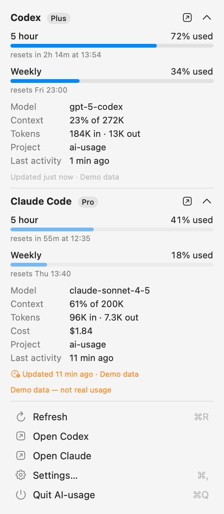

# AI-usage

A lightweight, native macOS menu bar app that shows how much of your AI coding-tool usage limits you have used — currently **OpenAI Codex** and **Anthropic Claude Code**.

```text
[OpenAI logo] 72%  [Claude logo] 41%
```

> **AI-usage never consumes AI/model tokens to obtain usage information.**
> It does not run `codex exec`, `claude -p`, call the OpenAI Responses API or the Anthropic Messages API, or ask any model about its own usage. It only reads telemetry and account metadata that the tools already expose locally. If a metric cannot be obtained without inference, it is not shown.

## Screenshots

Rendered with demo data (`--demo`):

| Menu bar | Detail panel |
|---|---|
|   |  |

_Settings window screenshots: TODO._

## Supported providers

| Provider | Tested with | Data sources |
|---|---|---|
| Codex | codex-cli 0.137.0 | `codex app-server` account metadata, `~/.codex/sessions/**/rollout-*.jsonl` |
| Claude Code | Claude Code 2.1.274 | `~/.claude.json` usage cache, `~/.claude/projects/*/*.jsonl` transcripts, optional status line bridge |

## Capability matrix

What is actually implemented today:

| Metric | Codex | Claude Code |
|---|---|---|
| 5 hour usage | ✅ app-server / session log | ✅ usage API / usage cache / status line |
| Weekly usage | ✅ | ✅ |
| Other limits | ✅ extra buckets reported by the account (e.g. `gpt-reserve`) | ✅ per-model weekly limits (Opus/Sonnet) when present; spend limit via status line |
| Reset time | ✅ | ✅ |
| Plan | ✅ | ✅ (from `oauthAccount.organizationType`) |
| Credits balance | ✅ when the account has credits | — not exposed locally |
| Current model | ✅ last turn of the newest session | ✅ last main-chain message of the newest session |
| Context usage | ✅ % of the model's context window | ✅ % with the status line bridge, otherwise token count only |
| Session tokens | ✅ cumulative input / output of the newest session | ✅ summed from the newest transcript (de-duplicated per API response) |
| Session cost | — Codex does not report cost | ✅ with the status line bridge (Claude Code's client-side estimate) |
| Project (cwd) | ✅ | ✅ |
| Last activity | ✅ | ✅ |

## How usage collection works

### Codex

1. **Session logs** — after every turn Codex appends a `token_count` event to the session's rollout file containing the account's `rate_limits` (primary/secondary windows with `used_percent`, `window_minutes`, `resets_at`) and token counters; `turn_context` events carry the model and working directory. AI-usage watches `~/.codex/sessions` with FSEvents and reads only the tail of the newest rollout file. Message contents are never parsed or stored.
2. **`codex app-server`** — Codex's own JSON-RPC server is started briefly over stdio and asked only `initialize`, `account/read` and `account/rateLimits/read`. These return account metadata (plan, usage windows, credits) and do not create threads or turns, so no tokens are used. The client has a hard allowlist of these methods, closes stdin after the answers arrive (app-server exits) and a watchdog kills the process after 15 s, so nothing lingers. It runs on launch, when the menu opens (at most every 2 minutes), on the optional background timer and when a window resets.

The most recent observation from either source wins.

### Claude Code

1. **Usage cache** — Claude Code itself fetches the account's utilization and caches it in `~/.claude.json` under `cachedUsageUtilization` with a fetch timestamp. AI-usage reads that cache (only the utilization buckets and the plan type; identity fields are ignored) and watches the file for changes.
2. **Transcripts** — the newest `~/.claude/projects/<project>/<session>.jsonl` is read incrementally (only new bytes) for model, token usage, working directory and timestamps. Message contents are never kept.
3. **Status line bridge (optional)** — Claude Code passes `rate_limits`, `context_window`, `cost` and `model` to the configured [status line](https://code.claude.com/docs/en/statusline) command after each reply. *Settings → Providers → Install Bridge…* installs a small `/bin/sh` script that stores an allowlisted subset of that JSON (no session titles, transcript paths or other text) in `~/Library/Application Support/AI-usage/claude/statusline.json`, then runs your previous status line command, so your status line keeps working. Installing backs up `~/.claude/settings.json`; *Remove Bridge* restores the previous configuration. The status line is a local hook and never triggers a model request.

4. **Live usage (on by default, Settings → Providers)** — AI-usage asks Anthropic's usage endpoint (`/api/oauth/usage`, the request behind Claude Code's `/usage`) with Claude Code's existing sign-in. It returns utilization counters only and consumes no tokens. The access token is read via `/usr/bin/security` from the `Claude Code-credentials` Keychain item for each request, held in memory only, never logged or stored, and never refreshed (expired tokens are left for Claude Code to renew). Throttled like Codex: launch, menu open (≤ every 2 min), background timer, window reset, manual refresh.

Because Claude Code only learns about usage when it talks to Anthropic for you, AI-usage shows the **last known value with its age** and never asks for fresh data.

### Freshness and states

Every snapshot carries the source and time the rate limits were observed. Data older than the configured threshold (30 minutes by default) is dimmed in the menu bar and marked with a clock icon in the panel. A window whose reset time has passed shows `–` / "window reset" instead of the old percentage. Providers report distinct states — *available*, *not installed*, *not signed in*, *no usage recorded yet*, *error* — and failures are never rendered as 0 %.

### Refresh strategy

- FSEvents on `~/.codex/sessions` and `~/.claude/projects`, kqueue on `~/.claude.json` (coalesced)
- refresh when the menu opens (configurable)
- one timer at the earliest known window reset
- optional background refresh, default every 15 minutes (only Codex's app-server query does anything beyond re-reading local files)
- a once-a-minute clock tick for countdowns; no tight polling

Measured on an M-series Mac: ~0 % CPU when idle, ~25–35 MB memory footprint.

## Menu bar configuration

Per provider (*Settings → Menu Bar*): show/hide, order, content (icon + usage, usage only, icon only), icon (provider logo, sparkle, provider symbol, glyph ✦/◈, name, none), primary and optional secondary value (5 hour, weekly, highest), used vs remaining, percent sign, window label (`5h 72%`), reset countdown (`72% 2h14m`). Changes apply immediately. The menu bar title is rendered as a template image, so it follows light/dark menu bars; official logos are not bundled: the default *Logo* style loads the monochrome menu bar template icons that ChatGPT.app (`chatgptTemplate`) and Claude.app (`TrayIconTemplate`) ship, at runtime, and falls back to an SF Symbol when the app is not installed.

## Privacy

- Everything stays on your Mac. No analytics, no telemetry, no backend, no network requests of its own. (The Codex CLI's `app-server`, when AI-usage starts it, talks to OpenAI the way Codex normally does — e.g. to answer `account/rateLimits/read`, the same request Codex's own UI makes to show your limits. AI-usage itself makes no network requests.)
- Transcripts and prompts are never uploaded, logged or persisted. Parsers extract numeric counters, model names, timestamps and working directories only.
- AI-usage persists only normalized metrics (`~/Library/Application Support/AI-usage/snapshots.json`) and preferences (`UserDefaults`). No credentials are stored. The only credential read is Claude Code's access token for the optional live usage request (in memory, per request).

## Development

Requirements: macOS 14+, Xcode 16+ (tested with Xcode 26.5), [XcodeGen](https://github.com/yonaskolb/XcodeGen) if you change `project.yml`.

```bash
xcodegen generate
```

```bash
xcodebuild -project AI-usage.xcodeproj -scheme AI-usage -derivedDataPath build/DerivedData build
```

```bash
xcodebuild -project AI-usage.xcodeproj -scheme AI-usage -derivedDataPath build/DerivedData test
```

```bash
open build/DerivedData/Build/Products/Debug/AI-usage.app
```

The app icon is generated by `swift scripts/make-app-icon.swift`.

Useful flags (Debug builds):

- `--demo` — deterministic demo data instead of real providers
- `--export-snapshots <dir>` — render the menu bar title and panel to PNGs, print the snapshots and quit (verification without screen recording permission)
- `AI_USAGE_HOME=<dir>` environment variable — pretend the home directory is `<dir>` (test missing / empty provider states)

### Project layout

```
AIUsage/
  App/            app entry point, debug snapshot exporter
  Core/           normalized model, provider protocol, store, preferences,
                  formatting, file watchers, defensive JSON helpers
  Providers/      Codex, Claude Code, demo providers
  UI/             menu bar label, detail panel, settings
AIUsageTests/     parser, formatter and model tests
```

Adding a provider: implement `UsageProvider` (an actor returning a normalized `UsageSnapshot`), declare its `ProviderCapabilities`, add a `ProviderID` and branding, and register it in `ProviderFactory`.

## Current limitations

- Local file formats of Codex and Claude Code are undocumented and may change; parsers are defensive and degrade to "no data" rather than crashing.
- With live usage turned off, Claude values come from Claude Code's own cache and can be tens of minutes old (shown dimmed as stale). The status line bridge only runs in the interactive CLI.
- Claude rate limits are only available for Pro/Max (claude.ai) sign-in; API-key users get session data only. Codex limits require ChatGPT sign-in.
- Session tokens/model describe the most recently active session only, not a sum over all sessions.
- Codex context percentage uses the last turn's total tokens divided by the model's context window; Codex's own UI may apply a small baseline correction.
- Launch at login uses `SMAppService` and works best when the app lives in `/Applications`.
- The app is ad-hoc signed; it is not sandboxed because it reads `~/.codex` / `~/.claude` and launches the Codex CLI.
